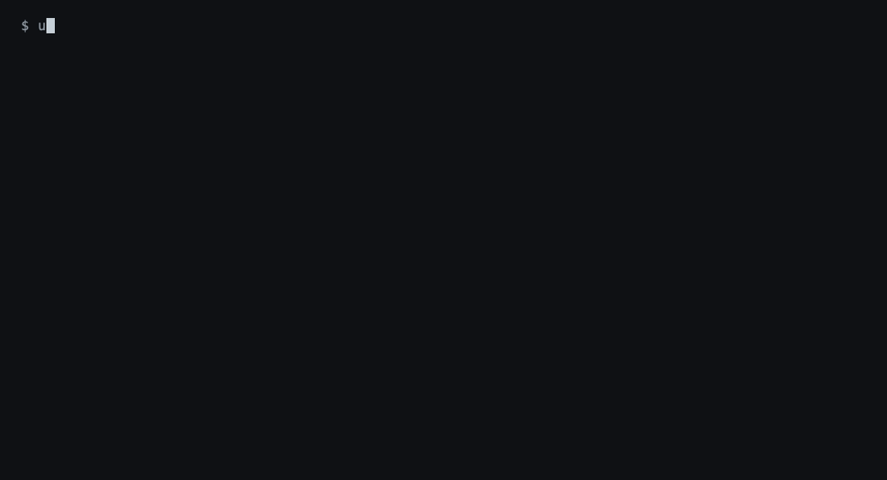

<p align="center">
  
</p>

<h1 align="center">Ülgen</h1>

<p align="center">Zaten kullandığınız kodlama araçları için EVREN</p>

<p align="center">
  <a href="https://github.com/mftnakrsu/ulgen/actions/workflows/ci.yml"></a>
  <a href="https://github.com/mftnakrsu/ulgen/releases/latest"></a>
  <a href="LICENSE"></a>
</p>

<p align="center">
  <a href="https://ulgen.mefby.com/tr/"><b>Web sitesi ve belgeler</b></a> ·
  <a href="README.md">English</a>
</p>

Ülgen, Savunma Sanayii Başkanlığı'nın (SSB) işlettiği model API'si [EVREN](https://ulgen.mefby.com/tr/evren/)'i, zaten kullandığınız açık kaynak kodlama araçlarına bağlar: Qwen Code, opencode, Codex CLI ve Claude Code.

Bu araçlar zaten iyi çalışıyor, EVREN de yetenekli açık ağırlıklı modeller sunuyor. Eksik olan aradaki parça: giriş yapmak, anahtarı güvende tutmak, kullanım koşullarını kabul etmek, kotayı izlemek, her aracın ayarını doğru yazmak ve Türkçe arayüz. Ülgen bu parçadır. Tek bir programdır; yeni bir kodlama ajanı değildir.

Adını Türk mitolojisindeki yaratıcı tanrı Ülgen'den alır. Komutun adı `ulgen`.

<p align="center">
  
</p>

Yukarıdaki kayıt gerçektir: `ulgen doctor`, `ulgen status`, ardından Claude Code bir dosyayı okuyup EVREN üzerinden yanıt veriyor. Kayıt [docs/assets/demo.tape](docs/assets/demo.tape) dosyasından [vhs](https://github.com/charmbracelet/vhs) ile üretildi ve gerçekte olduğundan hızlı oynatılıyor.

## Kurulum

Linux ve macOS:

```sh
curl -fsSL https://raw.githubusercontent.com/mftnakrsu/ulgen/main/scripts/install.sh | sh
```

Windows (PowerShell):

```powershell
irm https://raw.githubusercontent.com/mftnakrsu/ulgen/main/scripts/install.ps1 | iex
```

Pardus, Debian ve Ubuntu paketleri, kaynaktan derleme ve indirilen dosyanın doğrulanması için: [kurulum sayfası](https://ulgen.mefby.com/tr/install/).

## İlk kullanım

Bir EVREN hesabı (giriş e-Devlet ile yapılır) ve desteklenen araçlardan birinin kurulu olması gerekir.

```sh
ulgen
```

Bu kadar. İlk çalıştırmada Ülgen giriş yaptırır, kurulu araçları bulur, hangisini istediğinizi sorar, onu EVREN için ayarlar ve başlatır. Sonraki çalıştırmalarda aynı aracı doğrudan başlatır; `ulgen opencode` (ya da `qwen`, `codex`, `claude`) başka bir araca geçer, adın ardından yazdıklarınız araca iletilir.

Her adım ayrı bir komut olarak da durur:

```sh
ulgen login        # EVREN'in API anahtarı sayfasını açar, anahtarı sorar, koşulları gösterir, anahtarı kaydeder
ulgen setup qwen   # EVREN sağlayıcısını Qwen Code'a yazar
ulgen run qwen     # Qwen Code'u, anahtarı ortam değişkeni olarak vererek başlatır
```

`ulgen status` kalan günlük kotayı ve modelleri gösterir. Tek başına `ulgen setup`, araçları ve durumlarını listeler. Bir şey çalışmadığında `ulgen doctor` anahtarı, EVREN'i ve her aracı denetler, ne yapmanız gerektiğini söyler.

## Neler yapabilirsiniz

```sh
ulgen                                   # aracı bir kez seçin, sonra doğrudan kodlamaya başlayın
ulgen claude                            # bulunduğunuz projede, bir EVREN modeliyle Claude Code
ulgen qwen -p "bu depoyu açıkla"        # tek bir soru, yanıtı terminalde
ulgen doctor                            # bir şey ters gidiyorsa: ne olduğu ve ne yapılacağı
ulgen status                            # bugünkü kotadan ne kadar kaldığı
ulgen setup --remove all                # Ülgen'in ayarlarını bütün araçlardan geri alır
```

## Desteklenen araçlar

| Araç | `ulgen setup <ad>` | Kurulumun yazdığı |
|---|---|---|
| Qwen Code | `qwen` | `settings.json` içine EVREN modelleri |
| opencode | `opencode` | `opencode.json` içine EVREN sağlayıcısı |
| Codex CLI | `codex` | Kendine ait bir profil dosyası, `evren.config.toml`; sizin `config.toml` dosyanıza hiç yazılmaz |
| Claude Code | `claude` | Yalnızca EVREN işçileri için bir beceri dosyası; `ulgen run claude` ayar dosyası gerektirmez |

Değişen her dosyanın önce yedeği alınır; `--dry-run` değişikliği yazmadan gösterir. `ulgen setup --remove <ad>` kurulumu geri alır: Ülgen'in yazdığı gider, sizin yazdığınız kalır.

## Komutlar

```
  ulgen            giriş yapar, araç seçtirir, aracı ayarlar ve başlatır
  ulgen <araç>     aynısını tek bir araç için yapar: qwen, opencode, codex, claude

  ulgen login      EVREN'e giriş: API anahtarı sayfasını açar, anahtarı kaydeder, koşulların kabulünü kaydeder
  ulgen logout     kayıtlı anahtarı siler
  ulgen status     kalan günlük kota ve modeller
  ulgen doctor     anahtarı, EVREN'i ve araçları denetler; yanlış olan için ne yapılacağını söyler
  ulgen setup      kodlama araçlarını EVREN için ayarlar (qwen, opencode, codex, claude)
  ulgen run        bir aracı, anahtarı ortam değişkeni olarak vererek başlatır; Claude Code'u çevirici üzerinden

İleri düzey:
  ulgen worker     bir EVREN modelinde, bir görevi gözetimsiz yapmak için tek bir etkileşimsiz Claude Code çalıştırır
  ulgen proxy      çeviriciyi tek başına çalıştırır; Anthropic API'sini konuşan bir program için
  ulgen token      kayıtlı anahtarı başka bir programa verir
  ulgen version    sürümü yazdırır
```

Bir komutun seçenekleri için `ulgen <komut> -h` yazın. Bütün komutlar sistem dilini izler: Türkçe ya da İngilizce.

Ayrıntılı Türkçe kılavuz: [EVREN'i kodlama araçlarınızda kullanma](https://ulgen.mefby.com/tr/evren-ile-kodlama-araclari/).

## Anahtarınız sizde kalır

- İşletim sisteminin kimlik deposunda saklanır (sistemde yoksa yalnızca sizin okuyabildiğiniz bir dosyada), o da ancak EVREN anahtarı kabul ettikten sonra.
- Hiçbir aracın ayar dosyasına yazılmaz; araçlar onu, `ulgen run` kendilerini başlatırken ortam değişkeninden alır.
- Ekrana ya da günlüğe yazılmaz; sunucudan dönen hata iletilerinden de çıkarılır.
- Claude Code anahtarı hiç almaz: kendi makinenizde, Ülgen'in içindeki bir çeviriciyle konuşur.
- `ulgen run`, kendi ayar dosyası anahtarı başka bir adrese gönderebilecek bir projede aracı başlatmaz.

Bu ve diğer kararların gerekçeleri: [docs/design.md](docs/design.md) (İngilizce).

## Bilinen sınırlar

- Anthropic, Claude Code'un başka modellerle kullanılmasını desteklemez. `ulgen run claude` bir çevirici üzerinden çalışır ve bunu her çalıştırmada bir kez söyler.
- Tek seferlik bir çalıştırmada (`ulgen claude -p`) Claude Code, EVREN'in model adlarını tanımadığı için standart hataya bir satır yazar: `[claude-code:unrecognized_model] {…}`. Bu bir hata değil, bir bilgi satırıdır; istek olduğu gibi gider.
- Claude Code'un EVREN'de gösterdiği token sayıları tahminidir.
- Claude Code kapanırken `claude --resume <kimlik>` önerir. Olduğu gibi çalıştırılan bu komut Ülgen'den geçmez; oturumu EVREN'de `ulgen claude --resume <kimlik>` sürdürür.
- Windows'ta, başlatıcısı npm'in yazdığı standart dosya olmayan bir araç `cmd.exe` üzerinden başlatılır; o durumda argüman `"`, `%`, `^` ya da `!` içeremez.

## Derleme

Go 1.26 ya da daha yenisi.

```sh
go build ./cmd/ulgen   # ./ulgen dosyasını üretir (Windows'ta ulgen.exe)
go test ./...
```

## Katkı

[CONTRIBUTING.md](CONTRIBUTING.md) dosyasına bakın. Güvenlik sorunları herkese açık değil, özel olarak bildirilir: [SECURITY.md](SECURITY.md).

Ülgen bağımsız, ticari olmayan bir projedir. SSB, EVREN ya da ayarladığı araçların yapımcılarıyla bir bağı yoktur.

## Lisans

[AGPL-3.0-only](LICENSE).
